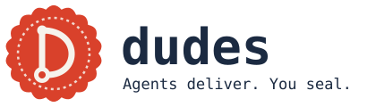

<p align="center">
  <picture>
    <source media="(prefers-color-scheme: dark)" srcset="docs/wordmark-dark.svg">
    
  </picture>
</p>

<p align="center"><b>Agents deliver. You seal.</b></p>

<p align="center">
  <a href="LICENSE"></a>
  <a href="ARCHITECTURE.md"></a>
  <a href="#what-is-real-today-and-what-is-vision"></a>
</p>

**Local, spec-first AI software delivery with a human sign-off, recorded in git.**

An idea goes in. The requirements are written and frozen first, then tests, code, a QA report and docs follow in a fixed order, one git commit per step. Between the steps a gate, a check that can say no, decides whether the run goes on. At the end it stops: you read the report, then seal it or send it back.

## Two ways in

| | **1. In your IDE agent, today** | **2. The engine, with local models** |
|---|---|---|
| What runs the flow | Claude Code, Cursor or Cline, following rule files. One agent plays the roles in turn (PM, tester, developer, QA). DUDES calls this the *role-play* | A Go program owns the sequence. Local models do the writing: Ollama serves them, Aider (an open-source coding CLI) edits the code |
| Gates | Rules the agent follows. Opt-in git hooks (`hooks/`) enforce the commit rules | Code. The engine runs them; a model cannot argue with one |
| You need | The IDE agent you already use. No GPU, no Docker | An Ollama host (a 24–32 GB GPU box for the code worker) and Docker for the Aider image |
| Your code goes to | The vendor of the model behind your agent. A hosted model sees it | Your Ollama host, and nowhere else |
| How far it is | How products are delivered with DUDES today | Early. Some local models clear the bench ladder; none has yet passed a replay of a real product's first tasks |
| Start | Copy the [starter](templates/product/) into your product repo: its `AGENTS.md` requires the rules, [`rules/DUDES.md`](rules/DUDES.md). Setup: [Claude Code](docs/CLAUDE_CODE_SETUP.md), [Cursor](docs/CURSOR_SETUP.md), [Cline](docs/CLINE_SETUP.md). First run: [the 10-minute walkthrough](docs/WALKTHROUGH.md) | `make try` below previews it, no model needed. Then [Your 27B in 10 minutes](docs/LOCAL_LLM_GUIDE.md) |

**Read next:** [Your 27B in 10 minutes](docs/LOCAL_LLM_GUIDE.md) · [the bench results, failures included](TREND.md#11-engine-workers--measured-skillsframeworkbench) · [the design](CORE.md)

---

## Five minutes, no model

You need Go 1.22 or newer (Go fetches the pinned 1.26 toolchain itself when yours is older), git, GNU make and a POSIX shell (on Windows: Git Bash). No model, no Docker.

```sh
git clone https://github.com/Thomas-Pietsch/dudes.git
cd dudes
make setup   # checks the tools, creates dudes.json, points this clone's git hooks at hooks/, builds bin/dudes
make try     # the whole lifecycle with stub workers, offline, in a scratch repo of its own
```

`make try` makes a throwaway git repo of its own under `.dudes/try/`: a fresh folder per tour, and this clone's history is never touched. It runs the whole lifecycle there with stub workers, fixed files in place of a model. It shows the sequence, the gates and the record, not what a model can do. No model, no network.

On the way, somebody edits the frozen spec, and the engine's own gate refuses to go on. It is the engine's check, in Go, with no model involved:

```text
$ dudes step -stub -skip-test
dudes: gate: spec-freeze: PRD changed since freeze (re-run dudes freeze after updating hello_PRD.md)
```

> The dudes are chill. The gates are not.

The tour takes the edit back, as a revert, so the record keeps both. The run goes on to the human gate, which prints the log and the exact command that seals:

```text
$ git log --oneline --decorate
09de06e (HEAD -> main) chore(phase): documentation [🔹engine]
0c81b32 chore(phase): qa [🔹engine]
e7c8357 chore(phase): implementation [🔹engine]
1903a80 Revert "docs(spec): the greeting ends with an exclamation mark [🔹try]"
8132db9 docs(spec): the greeting ends with an exclamation mark [🔹try]
d1c9e96 chore(phase): test_authoring [🔹engine]
37d7709 chore(phase): spec [🔹engine]
f0889c8 chore(phase): strategy [🔹engine]
0c31908 chore(phase): idea [🔹engine]
4e42d68 chore: try fixture

  cd .dudes/try/<date>-<time> && ../../../bin/dudes seal
```

Run it (`dudes.exe` on Windows): one more commit, `chore(phase): seal [🔹human]` with a `Sealed-by:` trailer, and a tag, `dudes/seal/hello/run-…`. The tour signs nothing, and `dudes seal` says `unsigned`. That is a run from start to end. `dudes reject "what to change"` sends it back instead.

`dudes` works in the current folder. Run it in your own repo, never in this clone; `make try` does that for you.

## How it works

```text
idea → strategy → spec → tests → code → QA → docs → you: seal | reject
```

The sequence is fixed and owned by the Go engine, not by a model. Each step is one short, fresh call to a bounded worker (Ollama for text, Aider for code). What the worker returns becomes a file and a commit, and the engine decides whether the run may go on. The five steps spell the name, **D-U-D-E-S**:

| | Step | What happens | What the engine insists on |
|---|---|---|---|
| **D** | **Define** | Idea, strategy, spec: the idea becomes requirements (SHALL) with GIVEN/WHEN/THEN scenarios, frozen with a hash | A spec in shape before anything is built |
| **U** | **Unit-test** | A test for every requirement, written before any code | Tests that cover every requirement; for a work item (a backlog entry with acceptance criteria) they fail first, for the right reason |
| **D** | **Develop** | A worker writes the code against the frozen spec; the engine runs the tests | A green test gate to leave the phase |
| **E** | **Evaluate** | QA report and docs, then a two-axis check: does it meet the spec, does it meet the standards | No open finding at the human gate |
| **S** | **Seal** | The run waits for you | Only a human seals |

**The human seal.** The run ends at a human gate. `dudes seal` commits the seal file as `[🔹human]` and sets an annotated git tag (`dudes/seal/<product>/<run>`, or `<product>-vX.Y.Z` for a release). `dudes reject "<why>"` sends the work back with your words as the next input. You judge the outcome, not the process. What is true about the seal:

- The engine sets it only on `dudes seal`, at the human gate, a phase no worker step runs in. Aider runs with shell commands off, and the text workers only return text. The optional Pi worker runs on your machine and can have a shell: a tag it makes by hand passes `dudes verify` only if your signing key is usable from that shell.
- It is not a lock. Anyone with a shell on the repository can run `dudes seal` or `git tag`.
- The tag is signed when your git can sign: `user.signingkey` set, with `gpg.format` openpgp, ssh or x509. Without a key it is an annotated tag and `dudes seal` says `unsigned`. The seal commit names you in a `Sealed-by:` trailer. `"seal": {"require_signature": true}` in `dudes.json` refuses an unsigned seal before anything is made.
- `dudes verify [tag]` checks a seal from git alone, the newest one by default: git's own `git tag -v` accepts the signature, the tag points at the seal commit with its `Sealed-by:` trailer, and the run's state says sealed. It exits 1 when one of them fails. A signature proves the key, not who held it: keep the key where an agent in your shell cannot use it, behind a passphrase or on a hardware key.

**Git as the record.** Every step is a commit: `chore(phase): <phase> [🔹engine]`, `chore(phase): seal [🔹human]`; on a work item's branch the commit names the task, `feat(BK-001a): code for AC-1 and AC-3, pass 2 [🔹engine]`. The run's state lives in git notes (`refs/notes/dudes/run`), next to spec freezes, test runs and acceptance results (`refs/notes/dudes/*`). No server, no database, no dashboard: `git log` is the audit trail. Notes and tags stay in your clone until you push them ([For companies](#for-companies) shows how).

The commands you will meet:

| Command | What it does |
|---|---|
| `dudes run -prompt "…" [-stub]` | Starts a run if there is none, then steps until the human gate. `-stub`: no model |
| `dudes status` | Where the run is: phase, status, spec, freeze. When a task waits for your review: its diff, its gate run, the worker's reply |
| `dudes seal [X.Y.Z]` · `dudes reject <text>` | Your two answers at the gate |
| `dudes verify [tag]` | Checks a seal from git alone: the signature, the seal commit, the run state |
| `dudes check` | The two-axis consistency check, spec against standards |
| `dudes doctor` | Probes git, Ollama, Aider, the packer and the config |
| `dudes events` | The run's event log, with the local tokens and time of each worker call a step makes, and who answered each pause; those are kept in git too, so they outlive a slice's worktree |
| `dudes do <item> -slice <file>` | Prepares one slice, a part of a work item, for the local workers: worktree, branch, pinned spec, a task for the failing tests and a task for the code. Each task you approve with `dudes decide` lands as one commit, so the branch merges as it is |
| `dudes redo <task> -by <role> "<why>"` | Sends a waiting task back to its worker with your feedback |
| `dudes land <slice> -by <role>` | Merges an ended slice and removes its worktree, branch and spec pins |
| `dudes help` | The rest; [`FEATURES.md`](FEATURES.md) lists every capability |

A product repo that includes [`make/bridge.mk`](make/bridge.mk) gets the same loop as make goals: `make slice`, `review`, `approve`, `redo` and `land`.

## What is real today, and what is vision

DUDES is early software. This is where it stands, measured rather than hoped.

**Real today**

- **The engine.** A Go binary on the standard library alone. A fixed phase machine, mechanical gates, run state in git notes, one commit per step, the human gate with its seal tag. Every capability has a feature ID (F1, F82, …) and a status in [`FEATURES.md`](FEATURES.md).
- **Local workers.** Text phases through your Ollama host, code through Aider in a pinned container image, tests in a toolchain image of your choice. A work item is split into a task that writes failing tests and a task that writes the code; each is gated.
- **The stub lifecycle.** The whole flow with stub workers, offline, in seconds: `make try` for you, `make bench` and the Go tests (`make ci`) for the engine's own regression.
- **The bench.** A ladder of three levels, L1 to L3. Each model runs each level three times from a fresh repository and is scored against a hidden test the worker never sees. The results are in [`TREND.md`](TREND.md) §1.1, **failures included**: some local models clear all three levels, but on a replay of a real product's first slices none passed, and the table says so. The finding that matters: a green gate is the worker's own judgement when the worker writes the test it must pass.
- **One real product item through the engine.** A backup feature of a pilot product, red tests and code by a local 27B model, reviewed six times. Every redo was a real defect the gates had let through. The hand-over around it was manual; `dudes do` is being built to take that over.
- **The role-play.** The same flow as rule files for IDE agents (Claude Code, Cursor, Cline). It is how products are delivered with DUDES today, and what the engine takes over stage by stage ([`rules/DUDES.md`](rules/DUDES.md)).

**Vision, not built**

- **The engine carrying the whole flow,** strategy and spec included. The stages and the exit check each must pass are in [`ROADMAP.md`](ROADMAP.md).
- **An always-on version:** it keeps running, shows what is in progress and takes instructions by voice or text, with git still the database. Not built, not scheduled.
- **Local models that hold several constraints at once.** The bet is better models, not longer prompts.

## What it is not

- **Not an IDE.** It sits beside yours: any editor, any OS.
- **Not a chat.** A process with a fixed order and its state in git. Every worker call starts fresh; nothing remembers a conversation.
- **Not a prompt pack.** In the engine the rules are code. A worker cannot be argued past a gate.
- **Not CI/CD.** It decides how a change is made and sealed, not how it ships.
- **Not a compliance product.** It leaves evidence and makes no legal claim ([For companies](#for-companies)).
- **Not autonomous yet.** A human, or a reviewing role, still reads the red tests and the code before the seal. The bench shows how far local models get without that.

## For companies

**What stays in-house, and what is cloud today.**

- With the engine and local models, prompts, code and specs go to the Ollama host you configure, a machine in your network. The code worker can run in a pinned container on your Docker host and the test gate in your own toolchain image (both are settings, below). The engine's only network client talks to that Ollama host, and Aider runs with analytics and update check off. Fetching models, images and the Go toolchain needs the internet; running the flow does not.
- In an IDE agent, the model vendor behind it receives the code and the specs. That is how products are delivered with DUDES today.
- The two can be mixed: the engine writes tests and code locally, and a reviewer reads them before the seal. A human reviewer keeps that in-house. A hosted agent as reviewer reads the code.

**Hardware.** A GPU box with 24–32 GB for the code worker. The models measured so far are 26–27B parameters at 4-bit quantization, run at a 32k to 64k context ([`docs/LOCAL_LLM_GUIDE.md`](docs/LOCAL_LLM_GUIDE.md)). The box can sit anywhere on your network: the engine, git and the test toolchain run on a developer machine and reach it through `ollama.base_url`.

**Auditability.** The record is plain git:

- One commit per step, with a role tag: `chore(phase): spec [🔹engine]`, `chore(phase): seal [🔹human]`.
- The spec's freeze (a hash of every source document), the test runs per commit, the acceptance results and the run state, as git notes under `refs/notes/dudes/`.
- The seal: the `<product>_SEAL.md` file in a commit whose `Sealed-by:` trailer names the sealer, and a tag, signed when the sealer's git can sign. `dudes verify` checks it from git alone.

Notes and tags stay in the clone until you push them. To keep them on a central remote:

```sh
git push origin <branch> --follow-tags                      # your branch and the annotated seal tags
git push origin 'refs/notes/dudes/*:refs/notes/dudes/*'     # the notes: git does not push them by default
git fetch origin 'refs/notes/dudes/*:refs/notes/dudes/*'    # in another clone: read them
```

**EU AI Act and GDPR: evidence, not compliance.** DUDES makes no legal claim. It produces evidence that your development process was followed: who decided what, on which frozen spec, with which test results, and that a human sealed the outcome or sent it back. That supports the record-keeping and human-oversight expectations of the EU AI Act and the accountability expectations of the GDPR. It does not classify your product's risk, replace a data protection impact assessment, or replace a lawyer. For the GDPR, local models keep the personal data in your code, test fixtures and specs inside your network; with a hosted model it goes to that vendor, under your contract with it. [`TREND.md`](TREND.md) §3 has the reading and the dates. It is not legal advice.

**License.** Apache-2.0, with an explicit patent grant ([License](#license)).

## The engine with local models

[`docs/LOCAL_LLM_GUIDE.md`](docs/LOCAL_LLM_GUIDE.md) says which model to pull and what to set. This is the wiring. In your own repo, copy [`dudes.example.json`](dudes.example.json) to `dudes.json` and set the product and the model host:

```sh
cd path/to/your-repo                                # a git repo; dudes works in the current folder
cp path/to/dudes/dudes.example.json dudes.json      # product, ollama, aider, packer
path/to/dudes/bin/dudes doctor                      # probes git, Ollama, Aider, config
path/to/dudes/bin/dudes run -prompt "CLI that greets the user"
```

`ollama.base_url` is the one model connection for every worker: the text workers call it, and Aider gets it as `OLLAMA_API_BASE`. Point it at the machine with the GPU, for example `http://<gpu-host>:11434` with Ollama there listening on `0.0.0.0`. With the Aider image (below), `127.0.0.1` is the container itself, so name the host by an address on your network. `dudes.json` is gitignored here; defaults apply when it is missing.

Set `test_command` so that it prints per-test results (`go test -v ./...` for Go). The evidence gate reads them; with a plain `go test ./...` a run stops short of the human gate with "software evidence not green".

| Worker | Default | Notes |
|---|---|---|
| Text, spec | Ollama HTTP | A fresh generate per phase; prior context is files only |
| Code | Aider CLI (Pi optional) | The engine owns the commits (`--no-auto-commits`) |
| Pack | Repomix CLI | A context packer: narrow globs per phase; optional |

**Code worker in its image.** `make worker-image` builds the pinned Aider image once (needs Docker). With `"aider": {"launch": ["sh", "<dudes>/scripts/worker.sh"]}` the engine starts every Aider run in it: one container per worker process, your repository mounted, nothing Aider-related installed on the host. `make shell DIR=<worktree>` opens the same view by hand.

**Test gate where the product runs.** The gate runs `test_command` on the engine's host unless `test_launch` names a launcher. The product's toolchain image: `"test_launch": ["sh", "<dudes>/scripts/worker.sh", "--image", "golang:1.26-bookworm", "--volume", "dudes-gomod:/go/pkg/mod"]`. Or the host's own Linux, in WSL on Windows: `"test_launch": ["sh", "<dudes>/scripts/linux.sh", "--go", "1.26.9"]`. A Linux product is then tested under Linux. `"format": {"command": ["…"], "ext": [".go"]}` runs a formatter on each pass's changed files before the commit. The design is in [`CORE.md`](CORE.md) §10.

## The bench, on any Ollama host

How far does a local model get as a worker? The ladder runs frozen tasks through the real engine (worker image, scope, gates, gate feedback) from the same start every time.

```sh
make worker-image    # once: the pinned Aider image (needs Docker)
make bench-models MODELS="qwen3.8:27b gemma4:26b" OLLAMA=http://<host>:11434
```

You need Docker and the models pulled on that Ollama host. Each run prints a result line, appends it as a git note in your clone (`NOTES=0` skips that) and keeps its logs in `.dudes/bench-models/`. A failing run is a result, not an error, and failures stay in the table. Levels, settings and the reference check are in [`bench/README.md`](bench/README.md). (`make bench` is the other bench: the hermetic stub lifecycle, no model.)

Run it on the models you have and open an issue with your result lines: [Your 27B in 10 minutes](docs/LOCAL_LLM_GUIDE.md) is the short path, and the [bench result form](https://github.com/Thomas-Pietsch/dudes/issues/new?template=bench-result.yml) takes them. Outside runs are what the bench lacks most.

## Platforms

Every goal, hook and script is POSIX `sh`, so the same commands run on Linux, macOS and Windows. Only how the shell and Docker get there differs.

| | Linux / macOS | Windows |
|---|---|---|
| Shell, git, coreutils | native | **Git Bash** (Git for Windows): run every `make` goal from it, not from cmd or PowerShell |
| make | native | GNU make on the PATH (e.g. `choco install make`) |
| Docker | Docker Engine | Docker Engine **inside WSL2** with `docker-buildx`, no Docker Desktop: `scripts/docker.sh` reaches it with `wsl.exe -e docker` and hands it `/mnt/c/…` paths |
| Models | `ollama.base_url`: local, or a LAN host with a GPU | same |

What the framework already absorbs on Windows: hooks set `LC_ALL=C`, the engine passes long prompts through files or stdin (the command line stops near 32k characters), and paths are converted where a Linux tool sees them (`C:\work` becomes `/c/work` in Git Bash and `/mnt/c/work` in WSL).

## More documents

The three links at the top are enough to start. For the rest:

| File | What it is |
|------|------------|
| [`MISSION.md`](MISSION.md) | Why: the north star |
| [`FEATURES.md`](FEATURES.md) | What the binary claims, by feature ID (F1, F82, …), each with a status: shipped, building, planned |
| [`ARCHITECTURE.md`](ARCHITECTURE.md) | How the Go engine is built, milestones M0 to M14 |
| [`ROADMAP.md`](ROADMAP.md) | The path: the stages (lanes) in which the engine takes over the flow from the IDE agents, each with an exit check (`make roadmap-check`) |
| [`TODO.md`](TODO.md) | The work list: Now, Next, Later (`make now`) |
| [`docs/BRAND.md`](docs/BRAND.md) | The identity: the seal, colors, voice |
| [`bench/README.md`](bench/README.md) | The bench ladder |

MISSION → CORE → FEATURES → ARCHITECTURE → Go is the chain. The mission and the design are stable (Go owns the process, models are workers, the human seals); models, harnesses and features evolve. Each file's job and the path of an idea: `CORE.md` §14 to §15.

## Contributing

Fork, branch, run `make ci`, open a pull request. [`CONTRIBUTING.md`](CONTRIBUTING.md) has the scope, the style and good first contributions; bench results on other models or hardware come first, and need no code. Bug reports go through the [issue forms](https://github.com/Thomas-Pietsch/dudes/issues/new/choose). A vulnerability goes to [`SECURITY.md`](SECURITY.md), privately.

## License

[Apache-2.0](LICENSE); see [`NOTICE`](NOTICE). The code is free to use, change and ship; the name DUDES and the seal mark stay with the project.

---

> Stay cool. Ship sealed. 🦭
